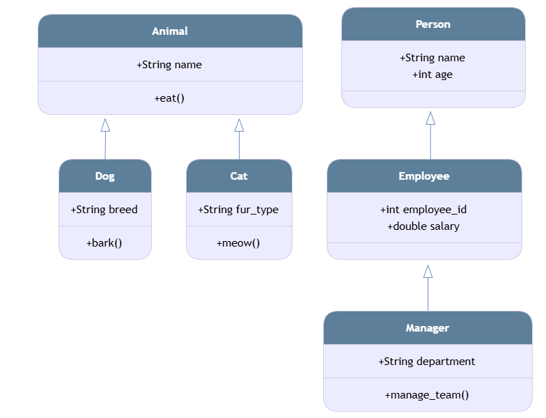

1. For each code example on single, multilevel, and hierarchical inheritance, create the corresponding class diagram in your notebook. Clearly identify the attributes and methods of each class. Show the correct inheritance relationship between classes. For single inheritance, the Animal class is the parent and Dog is the child. For multilevel, Person is the grandparent, Employee is the parent, and Manager is the child. For hierarchical inheritance, Animal acts as a single parent splitting into both Dog and Cat child classes.

2. Run the code examples in your IDE. Modify the code by adding getter and setter methods, changing object values, adding new objects, and adjusting method outputs. Observe how these changes affect the program. Experiment freely to strengthen your understanding of inheritance. Adding explicit getter and setter methods allows us to intercept and block invalid assignments like negative numbers before they modify internal variables, while using super().__init__() automatically handles initialization tasks up the chain without repeating code across every single subclass.
